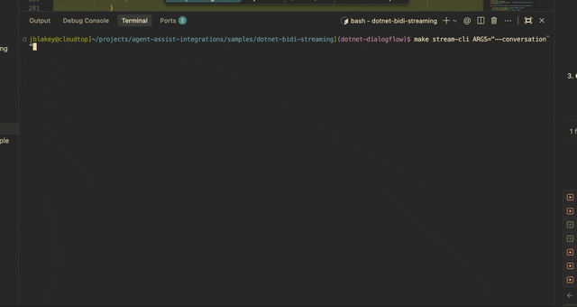
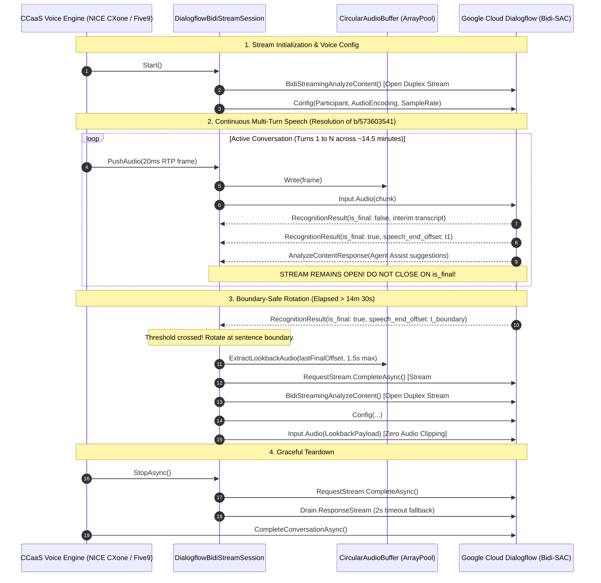

# Google Cloud Dialogflow Bidi-SAC .NET 8 Reference Architecture

[](https://dotnet.microsoft.com/download/dotnet/8.0)
[](https://grpc.io/)
[](https://cloud.google.com/agent-assist)
[]()

A high-performance, production-grade .NET 8 C# reference architecture and library for **Google Cloud Dialogflow v2beta1 Bidirectional Streaming Analyze Content (`BidiStreamingAnalyzeContent`)**, ported directly from battle-tested CCaaS voice integrations.

Designed as an authoritative reference pattern for **NICE CXone** (whose connector runs on modern .NET 8 on Linux using `grpc-dotnet`), **Five9**, **Genesys Cloud**, and other enterprise Contact Center as a Service (CCaaS) platforms integrating with Google Cloud Agent Assist.



---

## Architecture & Problem Overview

When integrating CCaaS voice streams with Dialogflow Agent Assist, enterprise connector implementations frequently encounter four critical production pitfalls:



### 1. The "Turn-Taking" Fallacy ([b/573603541](https://b.corp.google.com/issues/573603541))
* **Anti-pattern:** Closing and recreating the gRPC duplex stream every time an `is_final: true` transcript event is received.
* **Production Impact:** Extreme socket thrashing, latency spikes, severed interim speech on subsequent sentences, broken Agent Assist contextual memory, and premature stream closure causing transcription to permanently freeze mid-call.
* **Authoritative Solution:** Maintain a **single long-lived duplex stream** across speaker turns, pauses, and sentences. Turns are logical events inside the recognition stream, not stream boundaries.

### 2. Stream Deadlines & Boundary-Safe Rotation
* **Server Limit vs. Intermediate Network Constraints:**
  * **Server-Side Deadline:** Google Cloud Dialogflow's `BidiStreamingAnalyzeContent` API backend enforces an intrinsic RPC timeout of **30 minutes (1,800 seconds)** (unlike the legacy 120-second `StreamingAnalyzeContent` limit).
  * **Network & Proxy Safeguards:** Enterprise network paths (Cloud Run 5m default, AWS ALBs, Envoy/NGINX proxies, and corporate stateful NAT/firewalls) frequently terminate idle or long-lived TCP/gRPC streams after 10–15 minutes. Additionally, Google Front End (GFE) tasks periodically rebalance long-lived HTTP/2 connections.
  * **Average Handling Time (AHT) Coverage:** Because >95% of contact center customer calls conclude within 3–7 minutes, an enterprise-standard **14.5-minute** rotation threshold allows virtually 100% of standard calls to complete on a single unbroken stream, while providing a proactive buffer before hitting network dropouts or backend timeouts.
* **Anti-pattern:** Cutting the stream abruptly when a timer fires, truncating the customer or agent mid-word or mid-sentence.
* **Authoritative Solution:** `DialogflowBidiStreamSession` tracks elapsed stream time and rotates **only at sentence boundaries** (`is_final == true`) once `RestartThreshold` (~14.5 minutes) is crossed. A fallback safety cutoff at `MaxStreamLifetime` (14m 50s) protects against edge-case deadlocks (e.g. caller put on hold for 15+ minutes). In environments verified to support 30-minute gRPC sockets end-to-end, `RestartThreshold` can be tuned up to 28.5 minutes.

### 3. The Audio Lookback & Clipping Problem
* **Challenge:** During the milliseconds required to close stream $N$ and open stream $N+1$, the user may continue speaking. Audio sent during the cutover or immediately following the last final speech offset can be lost.
* **Authoritative Solution:** An internal circular ring buffer (`CircularAudioBuffer`) continuously records trailing raw audio frames in a zero-allocation `ArrayPool<byte>`. On stream rotation or transient retry, trailing audio recorded past the last `SpeechEndOffset` (up to 1.5 seconds) is extracted and prepended to the new stream request before piping live audio.

### 4. Clean Lifecycle Teardown & Deadlock Prevention
* **Anti-pattern:** Calling `CompleteConversation` while the gRPC audio stream is still actively open (triggers `FAILED_PRECONDITION`), or hanging indefinitely awaiting response EOF if remote endpoints stall.
* **Authoritative Solution:** Structured async disposal: draining the audio channel, calling `RequestStream.CompleteAsync()`, awaiting response completion with a graceful 2-second timeout fallback (`readTask.WaitAsync(2s)`), and then invoking `CompleteConversationAsync()`.

---

## Architectural Mapping: Python `asyncio` to .NET 8

| Python Implementation (`five9/mediastream-grpc`) | .NET 8 C# Equivalent | Design Detail |
| :--- | :--- | :--- |
| `bidi_streaming_analyze_content()` | `AsyncDuplexStreamingCall<BidiStreamingAnalyzeContentRequest, BidiStreamingAnalyzeContentResponse>` | Built into `Google.Cloud.Dialogflow.V2Beta1` via `ParticipantsClient`. |
| Request Generator (`async def gen_requests()`) | `System.Threading.Channels.Channel<ReadOnlyMemory<byte>>` | Thread-safe, non-blocking single-reader producer-consumer buffer between RTP audio and gRPC streaming writer. |
| Response Loop (`async for response in responses`) | `await foreach (var response in call.ResponseStream.ReadAllAsync(cancellationToken))` | Fully asynchronous, non-blocking response processing. |
| Audio Ring Buffer (`collections.deque`) | `CircularAudioBuffer` (`ArrayPool<byte>`) | Fixed-size zero-allocation circular buffer that slices trailing audio based on `SpeechEndOffset`. |
| Session Rotation (`time.time() - start > THRESHOLD`) | `Stopwatch` + Utterance Boundary Check | Evaluates at ~14.5 minutes on `result.IsFinal == true`. |

---

## Solution Structure

```
samples/dotnet-bidi-streaming/
├── DialogflowBidiStream.sln
├── Makefile                                 # Build, test, and CLI runner commands
├── Dockerfile                               # Multi-stage build with test verification
├── src/
│   └── DialogflowBidiStream/                # Core reusable .NET 8 library
│       ├── DialogflowBidiStream.csproj
│       ├── Buffers/
│       │   └── CircularAudioBuffer.cs        # High-performance audio ring buffer
│       ├── Core/
│       │   └── DialogflowBidiStreamSession.cs # 14.5m boundary rotation & bidi session
│       ├── Extensions/
│       │   └── ServiceCollectionExtensions.cs # .NET 8 Dependency Injection
│       ├── Five9/
│       │   └── Five9VoiceServiceImpl.cs      # VoiceStream gRPC servicer implementation
│       ├── Management/
│       │   └── DialogflowConversationManager.cs # Conversation & participant lifecycle
│       ├── Models/
│       │   ├── DialogflowStreamingOptions.cs # Configuration settings
│       │   ├── StreamStateEventArgs.cs       # Lifecycle events
│       │   ├── SuggestionEventArgs.cs        # Agent Assist suggestion events
│       │   └── TranscriptEventArgs.cs        # Real-time transcript events
│       └── Protos/
│           └── voice.proto                   # Five9 VoiceStream proto specification
├── samples/
│   ├── CliStreamer/                         # Runnable CLI Audio Streamer (ADC credentials)
│   │   ├── CliStreamer.csproj
│   │   ├── Program.cs                        # Real-time audio streaming console app
│   │   └── test_data/
│   │       └── sample_8k.mulaw               # Bundled 8kHz test audio
│   └── DialogflowBidiStream.Sample/          # Minimal ASP.NET Core gRPC server host
│       ├── DialogflowBidiStream.Sample.csproj
│       ├── Program.cs
│       └── appsettings.json
└── tests/
    └── DialogflowBidiStream.Tests/
        ├── DialogflowBidiStream.Tests.csproj
        ├── TestDoubles/
        │   └── TestStreamDoubles.cs          # In-memory gRPC stream harnesses & doubles
        ├── Unit/
        │   ├── TurnTakingAntiPatternTests.cs # Explicit verification of b/573603541 multi-turn stability
        │   ├── LookbackBufferMathTests.cs    # Byte-accurate lookback slicing math (8kHz & 16kHz)
        │   ├── TeardownLifecycleTests.cs     # Clean closure ordering & deadlock prevention
        │   ├── CircularAudioBufferTests.cs   # Ring buffer capacity & wrap-around
        │   ├── DialogflowBidiStreamSessionTests.cs # Session lifecycle & arg validation
        │   ├── DialogflowConversationManagerTests.cs # 404/409 idempotent conversation lifecycle
        │   ├── DialogflowStreamingOptionsTests.cs # Option defaults & config validation
        │   ├── Five9VoiceServiceImplTests.cs # VoiceStream gRPC servicer & call leg mapping
        │   ├── ProtobufSerializationTests.cs # Voice proto wire format serialization
        │   └── ServiceCollectionExtensionsTests.cs # DI container registration
        ├── Integration/
        │   ├── DialogflowStreamingEndToEndTests.cs # Full end-to-end voice streaming flow
        │   ├── StreamRotationIntegrationTests.cs # Boundary-safe 14.5m rotation & lookback replay
        │   └── TransientFaultRetryTests.cs   # Transient gRPC failure recovery & backoff
        └── Load/
            ├── AudioStreamingLoadTests.cs    # 25-50 concurrent calls, memory & GC Gen 2 stability
            └── ChannelBackpressureAndBurstLoadTests.cs # Burst contention & simultaneous rotations
```

---

## Comprehensive Test Suite

The test suite contains **56 automated tests** structured to prove correctness across every enterprise edge case:

### Test Tiers & Key Coverage

#### 1. Unit Tests (`Category=Unit`)
* **`TurnTakingAntiPatternTests.cs` (Directly targeting [b/573603541](https://b.corp.google.com/issues/573603541))**:
  * Feeds 4 consecutive conversational turns with `is_final: true`.
  * Asserts that `session.RotationCount == 1`.
  * Asserts that `RequestStream.CompleteAsync()` is **not** called.
  * Proves that speaker turns do not close or recreate the underlying stream.
* **`LookbackBufferMathTests.cs`**:
  * Verifies byte-accurate lookback slicing for 8kHz $\mu$-law ($1\text{ byte/sample}$) and 16kHz Linear PCM ($2\text{ bytes/sample}$).
  * Asserts that trailing audio between speech offset ($t = 2.0\text{s}$) and rotation ($t = 2.8\text{s}$) produces exactly 6,400 bytes with byte-for-byte pattern fidelity.
  * Asserts lookback window capping when delta exceeds `MaxLookbackSeconds` ($1.5\text{s}$).
* **`TeardownLifecycleTests.cs`**:
  * Tests structured shutdown when audio is actively being pushed.
  * Asserts that `PushAudio()` after teardown gracefully drops frames without throwing `ObjectDisposedException`.
  * Verifies idempotency of multiple `DisposeAsync()` and `StopAsync()` invocations.
* **`DialogflowConversationManagerTests.cs`**:
  * Tests 404 creation, 409 `AlreadyExists` race condition recovery, path generation for `"global"` vs regional locations, `ConversationProfile` `use_bidi_streaming` validation, and conversation completion handling `FailedPrecondition`.
* **`Five9VoiceServiceImplTests.cs`**:
  * Validates `StreamingConfig` protocol enforcement, 10-digit zero padding on numeric call IDs (`five9-0000009876`), and call leg role mapping (`Customer` $\to$ `EndUser`, `Agent` $\to$ `HumanAgent`).

#### 2. Integration Tests (`Category=Integration`)
* **`DialogflowStreamingEndToEndTests.cs`**:
  * End-to-end integration: client connects $\to$ sends config $\to$ receives start streaming ACK $\to$ streams audio frames $\to$ receives interim & final transcripts $\to$ disconnects $\to$ auto-completes conversation.
* **`StreamRotationIntegrationTests.cs`**:
  * Proves rotation is deferred during active speech and triggers on the first `is_final == true` utterance boundary after crossing the 14.5m threshold.
  * Proves fallback cutoff triggers if a caller remains silent or monologues past `MaxStreamLifetime` (14m 50s).
* **`TransientFaultRetryTests.cs`**:
  * Simulates transient gRPC errors (`StatusCode.Unavailable`, `DeadlineExceeded`, `ResourceExhausted`) and proves the session automatically reconnects Stream #2 with lookback audio.
  * Proves fatal errors (`PermissionDenied`) transition to `Faulted` and exit cleanly.

#### 3. Load & Stress Tests (`Category=Load`)
* **`AudioStreamingLoadTests.cs`**:
  * Runs 25 concurrent calls streaming 20ms frames simultaneously without packet loss or deadlocks.
  * Streams 10,000+ packets through the ring buffer, asserting that Gen 2 GC collections remain $\le 5$ collections due to `ArrayPool` reuse.
* **`ChannelBackpressureAndBurstLoadTests.cs`**:
  * Pushes rapid bursts of 3,000 packets across 10 parallel producer tasks into a single session under lock-free contention.
  * Simulates 10 concurrent active sessions undergoing stream rotation at the exact same instant under ongoing audio streaming.

---

## Running the Tests

Tests can be executed locally with `dotnet test` or inside the containerized SDK via `make`:

```bash
# Run all 56 unit, integration, and load tests
make test

# Run unit tests only (47 tests)
make test-unit

# Run integration tests only (5 tests)
make test-integration

# Run load and stress tests only (4 tests)
make test-load
```

---

## Prerequisites: Conversation Profile Configuration (`use_bidi_streaming`)

This library uses the bidirectional streaming API (`BidiStreamingAnalyzeContent`), which provides continuous streaming up to the 30-minute server limit. To ensure optimal performance and receive real-time Agent Assist suggestions, **Bidirectional Streaming must be enabled on your Conversation Profile**.

> [!IMPORTANT]
> **Why this configuration is required:**
> 1. **Agent Assist Suggestion Delivery (CES / GenAI):** Downstream suggestion generators (Knowledge Assist, Smart Reply, Agent Coaching, Summarization) inspect `initial_conversation_profile.use_bidi_streaming()`. If this flag is `false` (the default), the backend expects legacy turn-taking streaming events and will fail to bind suggestions to the bidirectional response stream, resulting in empty or missing suggestions on the agent desktop.
> 2. **Quota & Rate-Limiting Allocation:** Sessions without this flag can be routed to standard SAC concurrency quota pools instead of the dedicated `ConcurrentBidiStreamingSessionsPerProjectPerRegion`, risking premature `RESOURCE_EXHAUSTED` (429) errors.

### 1. Enable via Google Cloud Console
1. Navigate to the [Agent Assist Console](https://agentassist.cloud.google.com/) and select your project.
2. Click **Conversation Profiles** and select your active profile.
3. Scroll down to **Telephony Settings**.
4. Enable the toggle for **Use Bidirectional Streaming API**.
5. Click **Save**.

### 2. Enable via API (REST / gRPC) or Terraform
If you manage conversation profiles programmatically, ensure `useBidiStreaming: true` is set:
```json
{
  "name": "projects/PROJECT_ID/locations/global/conversationProfiles/CONVERSATION_PROFILE_ID",
  "useBidiStreaming": true,
  "sttConfig": {
    "useGeminiAsr": true,
    "useLongFormModel": true
  }
}
```

### 3. Built-In Runtime Diagnostic Check in .NET
The library includes a built-in diagnostic validation helper `ValidateConversationProfileAsync()` in `IDialogflowConversationManager`:
```csharp
// Inspects profile and logs a warning if use_bidi_streaming is not enabled
bool isBidiConfigured = await conversationManager.ValidateConversationProfileAsync(profileName);
if (!isBidiConfigured)
{
    logger.LogWarning("ConversationProfile '{ProfileName}' does not have 'use_bidi_streaming' enabled. Downstream suggestions will not emit.", profileName);
}
```

---

## Running the CLI Audio Streamer (`CliStreamer`)

A runnable console application is provided in `samples/CliStreamer` to allow partner engineers to stream audio to their own Google Cloud project using **Application Default Credentials (ADC)**.

### Prerequisites

1. **GCP Authentication:**
```bash
gcloud auth application-default login
```
2. **Conversation Profile:** Ensure your conversation profile has `Use Bidirectional Streaming API` enabled (see section above). The CLI runner will automatically validate this upon startup.

### Run against your GCP Project

Configure `.env` or pass variables on the command line:

```bash
# 1. Default: Streams realistic customer service turn with live speech transcription
make stream-cli

# 2. Multi-Turn Simulation: Streams all 6 customer & agent turns with turn-taking pauses
# Proves b/573603541: duplex stream stays open across consecutive speaker turns
make stream-cli ARGS="--conversation"

# 3. Stream custom audio file (supports raw .mulaw or 16-bit PCM .wav with auto-header stripping)
make stream-cli ARGS="--audio path/to/call.wav --rate 16000 --encoding Linear16"

# 4. Stream as END_USER role instead of HUMAN_AGENT
make stream-cli ARGS="--role END_USER"

# Or invoke directly with the .NET 8 CLI
dotnet run --project samples/CliStreamer -- \
  --project "your-project-id" \
  --profile "projects/your-project-id/locations/global/conversationProfiles/your-profile" \
  --conversation
```

### CLI Command-Line Flags & Configuration

| Flag | Environment Variable | Default | Description |
| :--- | :--- | :--- | :--- |
| `--project <ID>` | `PROJECT_ID` | *(Required)* | Google Cloud Project ID hosting Dialogflow / Agent Assist. |
| `--profile <NAME>` | `CONVERSATION_PROFILE_NAME` | *(Required)* | Resource name: `projects/*/conversationProfiles/*` or `projects/*/locations/*/conversationProfiles/*`. |
| `--location <LOC>` | `LOCATION_ID` | `global` | Dialogflow region (e.g. `global`, `us-central1`). |
| `--conversation` | — | `false` | **Multi-Turn Mode**: Simulates full 6-turn customer service call verifying [b/573603541](https://b.corp.google.com/issues/573603541). |
| `--audio <PATH>` | — | Bundled sample | Path to audio file. Supports raw `.mulaw` or 16-bit mono `.wav` (RIFF header stripped automatically). |
| `--role <ROLE>` | — | `HUMAN_AGENT` | Participant role to simulate: `HUMAN_AGENT` or `END_USER`. |
| `--rate <HERTZ>` | — | `8000` | Sample rate in Hertz: `8000` (standard telephony) or `16000` (wideband / HD voice). |
| `--encoding <ENC>` | — | `Mulaw` | Audio encoding: `Mulaw` (G.711u) or `Linear16` (16-bit signed PCM). |
| `--help`, `-h` | — | — | Displays usage summary and available options. |

### Live Output Example (Single Turn)

```text
================================================================================
  Google Cloud Dialogflow Bidi-SAC .NET 8 Audio Streamer CLI
  Authoritative Reference Pattern for Agent Assist Real-Time Voice
================================================================================

[Auth] Initializing Google Cloud Dialogflow gRPC Clients via ADC...
[Session] Conversation ID: cli-20261106002704-933e6cc
[Session] Role:            HUMAN_AGENT
[Session] Audio Format:    Mulaw @ 8000Hz
[Session] Resolving Dialogflow conversation and participant...
[State Changed] Starting: Starting streaming loop
[State Changed] Connected: Stream #1 connected
[Audio] Using bundled customer service call sample: test_data/sample_8k.mulaw

[Streaming] Piping audio (160 bytes every 20ms)... Press Ctrl+C to stop.

[Live Speech ASR] Hi, I'm calling to check on my delayed Google Store order...
>>> [FINAL TRANSCRIPT] (Offset: 5465ms): "Hi, I'm calling to check on my delayed Google Store order GS-1048-A for my Pixel Watch 3."

[Session] Closing stream and completing conversation...
[Success] Dialogflow Bidi-SAC streaming session completed successfully.
```

### Live Output Example (Multi-Turn Simulation `--conversation`)

```text
[Session] Mode:            Multi-Turn Conversation Simulation (6 Turns)
[Session] Verification:    b/573603541 turn-taking anti-pattern fix

[Turn 1/6] 🗣️  CUSTOMER (42,500 bytes / 5.3s)
[Live Speech ASR] Hi, I'm calling to check on my delayed Google Store order...
>>> [FINAL TRANSCRIPT] (Offset: 5310ms): "Hi, I'm calling to check on my delayed Google Store order GS-1048-A for my Pixel Watch 3."
[Turn-Taking Silence: 800ms natural pause (Stream stays active)]

[Turn 2/6] 🗣️  AGENT (64,000 bytes / 8.0s)
[Live Speech ASR] Thank you for contacting Google Store support! My name is Jordan...
>>> [FINAL TRANSCRIPT] (Offset: 8000ms): "Thank you for contacting Google Store support! My name is Jordan. I would be happy to check order GS-1048-A for you..."
[Turn-Taking Silence: 800ms natural pause (Stream stays active)]

...
[Streaming] All 6 conversational turns streamed in 45.3s over Stream #1 without rotation.
[Success] Dialogflow Bidi-SAC streaming session completed successfully.
```

---

## Direct CCaaS Integration (NICE CXone Agent Assist Hub)

If you are embedding the session directly into an existing CCaaS connector service:

```csharp
// 1. Validate Conversation Profile and resolve conversation & participant
await conversationManager.ValidateConversationProfileAsync(optionsSnapshot.Value.ConversationProfileName);
var conversation = await conversationManager.GetOrCreateConversationAsync(callId);
var participant = await conversationManager.CreateParticipantAsync(callId, Participant.Types.Role.HumanAgent);
string participantId = participant.Name.Split("/participants/").Last();

// 2. Instantiate and wire session
await using var session = new DialogflowBidiStreamSession(
    participantsClient,
    conversationId: callId,
    participantId: participantId,
    participantRole: "HUMAN_AGENT",
    options: optionsSnapshot,
    logger: logger);

session.TranscriptReceived += (sender, e) =>
{
    if (e.IsFinal)
    {
        Console.WriteLine($"[Final Transcript]: {e.Transcript}");
    }
};

session.SuggestionReceived += (sender, e) =>
{
    Console.WriteLine($"[Agent Assist Suggestion]: {e.Response}");
};

// 3. Start streaming worker
session.Start();

// 4. Pipe incoming raw audio frames (MULAW 8kHz or PCM 16kHz)
while (callIsActive)
{
    byte[] rtpFrame = await ReceiveNextRtpAudioChunkAsync();
    session.PushAudio(rtpFrame);
}

// 5. Clean teardown
await session.StopAsync();
await conversationManager.CompleteConversationAsync(callId);
```

---

## References

* [Google Cloud Agent Assist Bidi-Streaming API](https://docs.cloud.google.com/gemini-enterprise-cx/agent-assist/bidi-stream-api)
* [Google Cloud Agent Assist Voice Integration with Five9](https://docs.cloud.google.com/gemini-enterprise-cx/agent-assist/priv/five9-voice)
* [Google.Cloud.Dialogflow.V2Beta1 .NET Reference](https://docs.cloud.google.com/dotnet/docs/reference/Google.Cloud.Dialogflow.V2Beta1/latest)
* [Issue Tracker: b/573603541](https://b.corp.google.com/issues/573603541)
